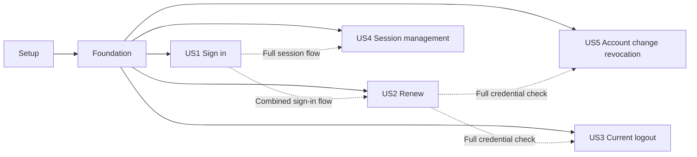

---

description: "Dependency-ordered tasks for Authentication and Sessions"
---

# Tasks: Authentication and Sessions

**Input**: Design documents from `specs/002-authentication-sessions/`

**Prerequisites**: [plan.md](plan.md), [spec.md](spec.md), [research.md](research.md), [data-model.md](data-model.md), [contracts/](contracts/), [quickstart.md](quickstart.md)

**Tests**: Included because the specification defines independent tests and measurable acceptance outcomes for every user story. Write behavior tests before each story's implementation; keep tests focused on externally visible results and security boundaries.

**Organization**: Tasks use repository-root-relative file paths. Run Maven commands from `services/identity-access-next`, the active service workspace. `[P]` means the task can be performed in parallel with other ready `[P]` tasks that touch different files.

## Phase 1: Setup

**Purpose**: Establish the service's existing Java 21/Maven baseline without changing sibling services or the user's in-progress files.

- [X] T001 Run the existing core baseline with `mvn -pl identityaccess-core -am test` from `services/identity-access-next` using `services/identity-access-next/pom.xml`; record any pre-existing failure in `specs/002-authentication-sessions/quickstart.md` before changing core files.

**Checkpoint**: Existing failures, if any, are distinguishable from this feature's failures.

---

## Phase 2: Foundational Session Rules

**Purpose**: Establish the shared session lifecycle and storage-neutral contracts required by every story.

**Critical path**: Complete this phase before user-story implementation. No infrastructure adapter, JWT logic, or generic token package belongs here.

- [X] T002 Add fixed-clock lifecycle tests in `services/identity-access-next/identityaccess-core/src/test/java/com/minewaku/chatter/identityaccess/authentication/internal/model/AuthenticationSessionTest.java` for UUIDv7 identity, positive lifetime, exact expiry boundary, nullable last use/revocation, monotonic last use, and one-time revocation.
- [X] T003 Implement issue/reconstitute and lifecycle rules in `services/identity-access-next/identityaccess-core/src/main/java/com/minewaku/chatter/identityaccess/authentication/internal/model/AuthenticationSession.java`: `sessionId` is "Required and globally unique; identifies a record, never used as the refresh proof" as a canonical UUIDv7 string; `userId` is "Required; one account owns the session"; `deviceInfo` is "Required; nonblank, at most 200 characters"; `issuedAt` is "Required, captured from injected `Clock`"; `expiresAt` is "Required and strictly after `issuedAt`"; `lastUsedAt` is "Initially absent; set on successful renewal, never earlier than `issuedAt`"; `revokedAt` is "Initially absent; set once when a revocation newly succeeds"; `now >= expiresAt` is expired.
- [X] T004 [P] Add plain `AuthenticationSessionIdGenerator`, `RefreshTokenGenerator`, and `AccessTokenIssuer` interfaces in `services/identity-access-next/identityaccess-core/src/main/java/com/minewaku/chatter/identityaccess/authentication/internal/port/AuthenticationSessionIdGenerator.java`, `services/identity-access-next/identityaccess-core/src/main/java/com/minewaku/chatter/identityaccess/authentication/internal/port/RefreshTokenGenerator.java`, and `services/identity-access-next/identityaccess-core/src/main/java/com/minewaku/chatter/identityaccess/authentication/internal/port/AccessTokenIssuer.java`; contract UUIDv7 IDs, 32 random bytes for opaque refresh credentials, and `issue(UserId, Email)` without JWT types.
- [X] T005 [P] Add `AuthenticationSessionRepository` in `services/identity-access-next/identityaccess-core/src/main/java/com/minewaku/chatter/identityaccess/authentication/internal/port/AuthenticationSessionRepository.java` with the exact create, presented-token lookup, ID lookup, conditional last-use, selected/other/all revocation operations and return semantics in `specs/002-authentication-sessions/contracts/ports.md`; keep raw refresh credentials out of `AuthenticationSession`.
- [X] T006 Add reusable in-memory session repository and deterministic generator/issuer fakes in `services/identity-access-next/identityaccess-core/src/test/java/com/minewaku/chatter/identityaccess/authentication/internal/application/AuthenticationTestFakes.java`; enforce owner filters, expiry, atomic-style conditional counts, and no raw credential field in `AuthenticationSession`.

**Checkpoint**: The session model tests pass, and the core exposes no storage- or JWT-specific type.

---

## Phase 3: User Story 1 - Sign In (Priority: P1) 🎯 MVP

**Goal**: An `ACTIVE` account with a matching password signs in once and receives one access credential and one opaque refresh credential tied to one `AuthenticationSession`.

**Independent Test**: With an active account and no sessions, sign in and verify exactly one session and both credentials; repeat with absent, wrong-password, malformed-password, `PENDING_VERIFICATION`, `LOCKED`, `SUSPENDED`, and `DELETED` accounts and verify zero sessions/credentials.

### Tests for User Story 1

- [X] T007 [P] [US1] Add sign-in acceptance tests in `services/identity-access-next/identityaccess-core/src/test/java/com/minewaku/chatter/identityaccess/authentication/internal/application/AuthenticateServiceTest.java` for the independent test above, device label boundaries, normalized email, UUIDv7 ID, one session per success, generic denial, access-issuer failure, and session-create failure.

### Implementation for User Story 1

- [X] T008 [US1] Define `AuthenticateUseCase.Command(String email, String password, DeviceInfo deviceInfo)`, nested `DeviceInfo(String label)` with "Nonblank, at most 200 characters", and `Authenticated(String accessToken, String refreshToken)` in `services/identity-access-next/identityaccess-core/src/main/java/com/minewaku/chatter/identityaccess/authentication/command/AuthenticateUseCase.java`.
- [X] T009 [US1] Implement `AuthenticateService` in `services/identity-access-next/identityaccess-core/src/main/java/com/minewaku/chatter/identityaccess/authentication/internal/application/AuthenticateService.java`: reuse `Email`, `UserAccountRepository`, `UserAccount.isAccessible()`, and `PasswordHasher.matches`; normalize all denied sign-ins to one credential failure; generate credentials in memory, create one session, and return only after create succeeds.
- [X] T010 [US1] Run the US1 tests and existing core tests from `services/identity-access-next` with `mvn -pl identityaccess-core -am test`; fix only feature-caused failures in `services/identity-access-next/identityaccess-core/src/main/java/com/minewaku/chatter/identityaccess/authentication/` or `services/identity-access-next/identityaccess-core/src/test/java/com/minewaku/chatter/identityaccess/authentication/`.

**Checkpoint**: Sign-in alone is a usable core MVP and can be demonstrated with in-memory ports.

---

## Phase 4: User Story 2 - Continue an Active Session (Priority: P1)

**Goal**: Renew access repeatedly with the original refresh credential, without rotation or a new session.

**Independent Test**: Seed one valid session and renew twice; verify two access credentials, one unchanged refresh association, updated `lastUsedAt`, and no new session. Check revoked, exact-expiry, unknown, malformed, and inaccessible-account cases.

### Tests for User Story 2

- [X] T011 [P] [US2] Add fixed-clock renewal acceptance tests in `services/identity-access-next/identityaccess-core/src/test/java/com/minewaku/chatter/identityaccess/authentication/internal/application/RefreshAccessTokenServiceTest.java` for repeated renewal, no rotation, `lastUsedAt`, `now == expiresAt`, revoked/unknown tokens, all non-`ACTIVE` statuses, issuer failure, and conditional-touch failure without returned credentials.

### Implementation for User Story 2

- [X] T012 [US2] Define `RefreshAccessTokenUseCase.Command(String refreshToken)` and `Refreshed(String accessToken)` in `services/identity-access-next/identityaccess-core/src/main/java/com/minewaku/chatter/identityaccess/authentication/command/RefreshAccessTokenUseCase.java`.
- [X] T013 [US2] Implement `RefreshAccessTokenService` in `services/identity-access-next/identityaccess-core/src/main/java/com/minewaku/chatter/identityaccess/authentication/internal/application/RefreshAccessTokenService.java`: resolve by presented credential, require usable session and `ACTIVE` owner, prepare only a new access credential, conditionally update last use, and return only after the update succeeds.
- [X] T014 [US2] Run the US2 and existing core tests with `mvn -pl identityaccess-core -am test` from `services/identity-access-next`; inspect failures in `services/identity-access-next/identityaccess-core/src/test/java/com/minewaku/chatter/identityaccess/authentication/internal/application/RefreshAccessTokenServiceTest.java` before proceeding.

**Checkpoint**: A seeded session renews independently; US1 sign-in plus US2 renewal works as a combined flow.

---

## Phase 5: User Story 5 - End Sessions After Account Changes (Priority: P1)

**Goal**: Successful password change, suspension, and deletion revoke all retained sessions synchronously; rejected and no-op changes do not.

**Independent Test**: Seed several sessions, perform each existing account command, and verify the old refresh credentials cannot renew; wrong-password, invalid-transition, and unchanged-password cases preserve session state.

### Tests for User Story 5

- [X] T015 [P] [US5] Add coordinator tests in `services/identity-access-next/identityaccess-core/src/test/java/com/minewaku/chatter/identityaccess/authentication/internal/application/AuthenticationSessionRevocationCoordinatorTest.java` for one supplied revocation time, all owned retained sessions, exact changed count, and propagated repository failure.
- [X] T016 [P] [US5] Extend `services/identity-access-next/identityaccess-core/src/test/java/com/minewaku/chatter/identityaccess/user/internal/application/UserAccountApplicationServiceTest.java` with password-change, suspension, and soft-delete revocation tests, preserving existing in-progress test edits; assert one revoke-all call only for an actual change, zero for no-op/rejected changes, and no success on revocation failure.

### Implementation for User Story 5

- [X] T017 [US5] Implement `AuthenticationSessionRevocationCoordinator.revokeAllFor(UserId)` using `Clock` and `AuthenticationSessionRepository.revokeAllByUserId` in `services/identity-access-next/identityaccess-core/src/main/java/com/minewaku/chatter/identityaccess/authentication/internal/application/AuthenticationSessionRevocationCoordinator.java`; propagate failures and avoid messaging.
- [X] T018 [P] [US5] Invoke the coordinator only when `changePassword` returns `changed = true`, within the existing transaction and before success, in `services/identity-access-next/identityaccess-core/src/main/java/com/minewaku/chatter/identityaccess/user/internal/application/command/ChangePasswordService.java`.
- [X] T019 [P] [US5] Invoke the coordinator only when `suspend()` changes state, within the existing transaction and before success, in `services/identity-access-next/identityaccess-core/src/main/java/com/minewaku/chatter/identityaccess/user/internal/application/command/SuspendUserAccountService.java`.
- [X] T020 [P] [US5] Invoke the coordinator only when `softDelete()` changes state, within the existing transaction and before success, in `services/identity-access-next/identityaccess-core/src/main/java/com/minewaku/chatter/identityaccess/user/internal/application/command/SoftDeleteUserAccountService.java`.
- [X] T021 [US5] Run account-change and renewal tests with `mvn -pl identityaccess-core -am test` from `services/identity-access-next`; verify the acceptance cases in `services/identity-access-next/identityaccess-core/src/test/java/com/minewaku/chatter/identityaccess/user/internal/application/UserAccountApplicationServiceTest.java` and record any unresolved cross-store atomicity obligation in `specs/002-authentication-sessions/quickstart.md`.

**Checkpoint**: Existing account commands have immediate core-level revocation behavior; production cross-store atomicity remains an adapter integration gate.

---

## Phase 6: User Story 3 - End the Current Session (Priority: P2)

**Goal**: Sign out the session identified by its refresh credential exactly once.

**Independent Test**: Seed one active session, sign out with its credential twice, and verify `true` then `false`; expired, unknown, and revoked credentials return `false`, while other sessions stay usable.

### Tests for User Story 3

- [X] T022 [P] [US3] Add idempotent sign-out tests in `services/identity-access-next/identityaccess-core/src/test/java/com/minewaku/chatter/identityaccess/authentication/internal/application/LogoutCurrentSessionServiceTest.java` for the independent test, inactive owner, conditional-write race, and later renewal denial.

### Implementation for User Story 3

- [X] T023 [US3] Define `LogoutCurrentSessionUseCase.Command(String refreshToken)` and `Result(boolean revoked)` in `services/identity-access-next/identityaccess-core/src/main/java/com/minewaku/chatter/identityaccess/authentication/command/LogoutCurrentSessionUseCase.java`.
- [X] T024 [US3] Implement `LogoutCurrentSessionService` in `services/identity-access-next/identityaccess-core/src/main/java/com/minewaku/chatter/identityaccess/authentication/internal/application/LogoutCurrentSessionService.java`: resolve the presented token, require usable session and `ACTIVE` owner, conditionally revoke the owned ID, and return `true` only for a new revocation.
- [X] T025 [US3] Run `mvn -pl identityaccess-core -am test` from `services/identity-access-next` and verify `services/identity-access-next/identityaccess-core/src/test/java/com/minewaku/chatter/identityaccess/authentication/internal/application/LogoutCurrentSessionServiceTest.java` passes with the full core suite.

**Checkpoint**: Current-session logout works independently with a seeded session and completes the sign-in/renew/sign-out flow with US1 and US2.

---

## Phase 7: User Story 4 - Review and End Sessions (Priority: P3)

**Goal**: Show only the caller's retained sessions and allow password-confirmed selected or other-session revocation while preserving the designated current session.

**Independent Test**: Seed 100 sessions for one account and sessions for another; list only the first account's records, revoke one owned ID, then revoke all other IDs with the correct password; verify ordered safe views, exact counts, ownership, idempotency, and current-session survival.

### Public contracts and query port

- [X] T026 [P] [US4] Define `LogoutSessionUseCase.Command(long userId, String sessionId, String currentPassword)` and `Result(boolean revoked)` in `services/identity-access-next/identityaccess-core/src/main/java/com/minewaku/chatter/identityaccess/authentication/command/LogoutSessionUseCase.java`.
- [X] T027 [P] [US4] Define `LogoutOtherSessionsUseCase.Command(long userId, String currentSessionId, String currentPassword)` and `Result(int revokedCount)` in `services/identity-access-next/identityaccess-core/src/main/java/com/minewaku/chatter/identityaccess/authentication/command/LogoutOtherSessionsUseCase.java`.
- [X] T028 [P] [US4] Define `FindSessionsQuery.Command(long userId)` and `SessionView(sessionId, userId, deviceInfo, issuedAt, expiresAt, lastUsedAt, revokedAt)` in `services/identity-access-next/identityaccess-core/src/main/java/com/minewaku/chatter/identityaccess/authentication/query/FindSessionsQuery.java`; `sessionId` is a canonical UUIDv7 string, `userId` and `deviceInfo` are required, `issuedAt`/`expiresAt` are required, and `lastUsedAt`/`revokedAt` are nullable.
- [X] T029 [US4] Add `AuthenticationSessionViewRepository.findByUserId(UserId)` in `services/identity-access-next/identityaccess-core/src/main/java/com/minewaku/chatter/identityaccess/authentication/internal/port/AuthenticationSessionViewRepository.java`; contract owner-only retained views, `issuedAt` descending then `sessionId` ascending, and no raw credential or digest.

### Tests for User Story 4

- [X] T030 [P] [US4] Add targeted sign-out tests in `services/identity-access-next/identityaccess-core/src/test/java/com/minewaku/chatter/identityaccess/authentication/internal/application/LogoutSessionServiceTest.java` for correct/wrong password, owned/foreign/missing ID, retained expired session, and repeat result `false`.
- [X] T031 [P] [US4] Add other-session sign-out tests in `services/identity-access-next/identityaccess-core/src/test/java/com/minewaku/chatter/identityaccess/authentication/internal/application/LogoutOtherSessionsServiceTest.java` for exact newly revoked count, current-session survival, wrong password, foreign/expired/revoked current ID, retained expired others, and repeat count zero.
- [X] T032 [P] [US4] Add query tests in `services/identity-access-next/identityaccess-core/src/test/java/com/minewaku/chatter/identityaccess/authentication/internal/application/FindSessionsServiceTest.java` for 100 owned records, stable ordering, nullable timestamps, retained expired/revoked records, no foreign records, and no refresh credential/digest exposure.

### Implementation for User Story 4

- [X] T033 [P] [US4] Implement password-confirmed, owner-scoped, idempotent targeted revocation in `services/identity-access-next/identityaccess-core/src/main/java/com/minewaku/chatter/identityaccess/authentication/internal/application/LogoutSessionService.java` using `UserAccountRepository`, `PasswordHasher.matches`, and `AuthenticationSessionRepository.revokeBySessionId`.
- [X] T034 [P] [US4] Implement password-confirmed other-session revocation in `services/identity-access-next/identityaccess-core/src/main/java/com/minewaku/chatter/identityaccess/authentication/internal/application/LogoutOtherSessionsService.java`: require an `ACTIVE` owner and usable owned current ID, exclude it, and return the repository's actual newly revoked count.
- [X] T035 [P] [US4] Implement owner-scoped session listing in `services/identity-access-next/identityaccess-core/src/main/java/com/minewaku/chatter/identityaccess/authentication/internal/application/FindSessionsService.java`; require an `ACTIVE` account and use `AuthenticationSessionViewRepository` without exposing credential data.
- [X] T036 [US4] Run `mvn -pl identityaccess-core -am test` from `services/identity-access-next` and verify all three US4 test files under `services/identity-access-next/identityaccess-core/src/test/java/com/minewaku/chatter/identityaccess/authentication/internal/application/` pass with the earlier stories.

**Checkpoint**: The approved session-list and password-confirmed management flows are complete at the core boundary.

---

## Phase 8: Polish & Cross-Cutting Concerns

**Purpose**: Verify the whole core feature and preserve adapter-boundary obligations for later work.

- [X] T037 Run `mvn -pl identityaccess-core -am test` and `mvn -pl identityaccess-core -am spotless:check` from `services/identity-access-next`; resolve feature-caused failures and record results in `specs/002-authentication-sessions/quickstart.md`.
- [X] T038 Review `services/identity-access-next/identityaccess-core/src/main/java/com/minewaku/chatter/identityaccess/authentication/` against `specs/002-authentication-sessions/contracts/ports.md` and `specs/002-authentication-sessions/spec.md`: no JWT/storage technology in core, no readable refresh credential in models/views/logs, no rotation or messaging; keep cross-store atomicity and runtime performance as later adapter gates in `specs/002-authentication-sessions/quickstart.md`.

---

## Dependencies & Execution Order

### Phase dependencies

1. Phase 1 baseline precedes changes. Phase 2 supplies `AuthenticationSession` and shared ports and blocks every user story.
2. Phases 3 and 4 deliver sign-in then renewal in user-visible order. Phase 5 uses the same session repository to integrate account changes. Phase 6 adds current-session logout. Phase 7 adds selected/other-session controls and listing.
3. Phase 8 follows all desired story phases. No phase requires infrastructure, presentation, or sibling-service implementation.

### User-story dependency graph

Each story can be tested with seeded in-memory accounts and sessions once Phase 2 is complete. Dashed edges are integration checkpoints, not blockers for writing a story's tests or service.

### Within each story

- Write acceptance tests against its public behavior, then add public contracts, then services and integration. Tests may fail to compile until their contracts are added; they must pass at the story checkpoint.
- Complete the account-change coordinator before changing the three existing account services. Preserve the user's in-progress registration and email-verification work.
- `[P]` tasks are parallel only after their shared prerequisites are complete; tasks touching the same file remain sequential.

### Parallel execution examples by story

| Story | Ready work that can run in parallel |
|-------|-------------------------------------|
| US1 | No intra-story pair; T007–T010 are sequential. After Phase 2, T007 can proceed alongside US2's T011. |
| US2 | No intra-story pair; T011–T014 are sequential. Its tests can be prepared alongside US5's T015/T016 after Phase 2. |
| US5 | T015 and T016 are separate test files; after T017, T018, T019, and T020 edit distinct account services. |
| US3 | No intra-story pair; T022–T025 are sequential. T022 can proceed alongside US4's T026–T028 after Phase 2. |
| US4 | T026–T028 define separate contracts; T030–T032 use separate test files; T033–T035 implement separate services after their contracts and tests are ready. |

## Implementation Strategy

### MVP first

1. Complete Phases 1 and 2.
2. Complete Phase 3 (US1) and its independent sign-in checkpoint. This is the smallest usable core slice.
3. Add Phase 4 (US2) to support continued access, then Phase 5 (US5) for account-change security, before the P2/P3 controls.

### Incremental delivery

Complete and verify each story checkpoint in the listed priority order: US1 → US2 → US5 → US3 → US4. Keep later adapter integration gates explicit in `specs/002-authentication-sessions/quickstart.md`; this task list implements the approved core scope only.

## Notes

- Every unchecked task is a concrete action with an exact file path or command workspace; task IDs are sequential.
- The source brief calls the model `RefreshSession`; the approved canonical name is `AuthenticationSession`.
- Keep existing uncommitted work outside these tasks intact.
